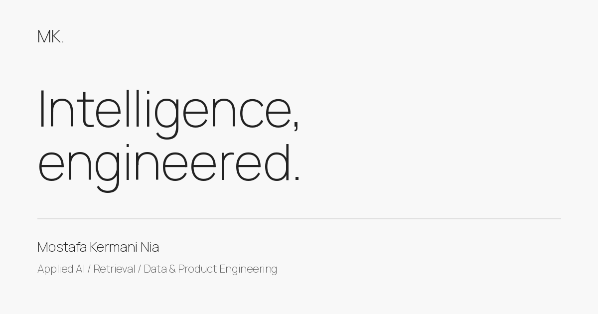

# Mostafa Kermani Nia — Personal Portfolio

A personal portfolio bringing together selected work in **applied AI, retrieval, data systems, and product engineering**, alongside research and teaching at the University of Tehran.

[Visit the website](https://mostafa-kermaninia.github.io/) · [Download my CV](https://mostafa-kermaninia.github.io/assets/download/CV.pdf) · [LinkedIn](https://www.linkedin.com/in/mostafakermaninia/) · [فارسی](README.fa.md)



## Explore

- **Selected work:** VideoMap, RamonAI Visual Search, Grantia, ORBIT, Commerce Experience, Majara, and MOMIS.
- **Research:** ongoing work in Byzantine-robust federated learning and vision-language models.
- **Teaching:** machine-learning academic leadership and project-based Speech & Audio AI instruction.
- **Background:** industry contributions, role timelines, education, and contact details.

Each case study describes the problem, my contribution, engineering decisions, and the outcome in context. Industry-project cover illustrations are labeled; project scope is distinguished from measured outcomes.

## Architecture

This is a small, **dependency-free static site**, built with Node.js, semantic HTML, CSS, and progressive JavaScript enhancement. Every page is generated as complete HTML: navigation, project content, native disclosure controls, and downloads work without client-side rendering.

The original React/Vite implementation is retained in Git history. A static architecture fits the portfolio’s content and GitHub Pages hosting, while reducing runtime dependencies and giving each project a directly accessible page.

| Area | Implementation |
|---|---|
| Rendering | Node.js templates and structured content |
| Styling | Responsive CSS, monochrome palette, locally hosted Manrope |
| Interactions | Project filters, mobile navigation, email copy feedback |
| Hosting | Existing GitHub Pages `gh-pages` branch |
| Accessibility | Semantic landmarks, skip link, focus indicators, native details, reduced-motion support |
| Discoverability | Per-page metadata, canonical URLs, sitemap, social card, Person structured data |
| Dependencies | No npm packages required to build or run |

## Local development

Requires **Node.js 22 or newer**. No dependency installation or credentials are needed.

```sh
git clone https://github.com/mostafa-kermaninia/mostafa-kermaninia.github.io.git
cd mostafa-kermaninia.github.io
npm run dev
```

Open `http://127.0.0.1:8080`. After editing source, run `npm run build` again and refresh. The development server deliberately does not include a file watcher or SPA fallback.

```sh
npm run check    # JavaScript syntax checks
npm test         # Build, link/metadata/content checks, HTTP and interaction tests
npm run build    # Generate dist/
npm run preview  # Serve an existing build
```

## Project structure

```text
src/
  content.mjs      Profile, projects, experience, teaching and capabilities
  render.mjs       Shared layout and page templates
  styles.css       Responsive design system and page layouts
  site.js          Progressive interactions
scripts/
  build.mjs        Generates HTML routes, sitemap, robots and redirects
  serve.mjs        Local static server with real 404 behavior
  check.mjs        Syntax checks
tests/
  site.test.mjs    Publication and behavior checks
public/
  fonts/           Manrope font and its SIL Open Font License
  images/          Portrait and social sharing image
  assets/download/ CV and retained academic downloads
docs/
  CONTENT.md       Content editing and factual conventions
  DESIGN.md        Visual direction and accessibility decisions
  DEPLOYMENT.md   GitHub Pages publication and rollback
```

## Update content

Edit `src/content.mjs` for project descriptions, roles, links, dates, and contact information. Shared templates live in `src/render.mjs`. Replace `public/assets/download/CV.pdf` to update the primary CV; keep the same path so existing links remain useful.

Read [the content guide](docs/CONTENT.md) before adding metrics, employment titles, or research claims. [The design guide](docs/DESIGN.md) documents the visual system.

## Publishing

The repository keeps **source on `main`** and **generated output on `gh-pages`**, preserving the existing domain and hosting configuration. The checks workflow validates source changes; it does not publish automatically.

Build and test before publishing. Commit the source to `main`, then publish the matching `dist/` output to `gh-pages` using an authenticated Git account with repository access. Full commands and rollback instructions are in [DEPLOYMENT.md](docs/DEPLOYMENT.md).

Direct project URLs resolve to real `index.html` files. The former `/case-study/grantia`, `/case-study/majara`, and `/case-study/momis` paths redirect to their new `/work/` equivalents. Unknown pages use a useful `404.html` instead of redirecting every error to the homepage.

## Validation and limits

The automated tests verify internal links and fragments, downloadable assets, metadata, core factual consistency, legacy redirects, HTTP routing, filtering, menu behavior, and clipboard success/failure feedback. Client-interaction tests use a minimal DOM fixture; they are not browser-rendering or accessibility certification.

Layout, performance, and assistive-technology behavior should also be reviewed in real browsers when making visual changes. No unmeasured Lighthouse score or field-performance claim is made for this website.

## Credits and rights

- Visual direction inspired by [Wolfpixel UI/UX’s Personal Portfolio Website Design](https://dribbble.com/shots/24978876-Personal-Portfolio-Website-Design). Layout, copy, project artwork, and implementation are adapted specifically for this portfolio; the reference’s identity, photography, and assets are not included.
- Manrope is locally hosted under the [SIL Open Font License](public/fonts/OFL-Manrope.txt). Upstream: [Google Fonts](https://github.com/google/fonts/tree/main/ofl/manrope).
- Portrait, CV, personal content, and project descriptions belong to their respective owners. Industry-project descriptions do not imply company endorsement.
- No blanket software or media license is granted by this repository. Contact the author about reuse.

## Contact

[mostafakermaninia@gmail.com](mailto:mostafakermaninia@gmail.com) · [GitHub](https://github.com/mostafa-kermaninia) · [LinkedIn](https://www.linkedin.com/in/mostafakermaninia/)
